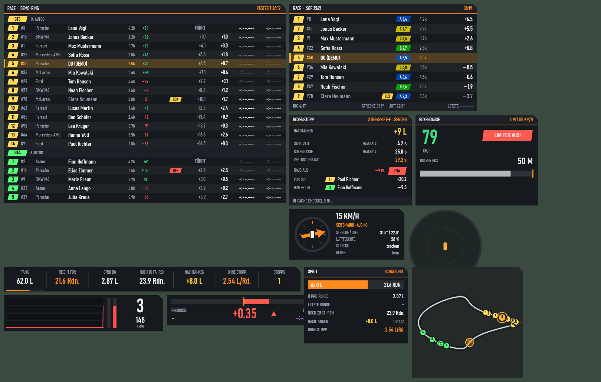
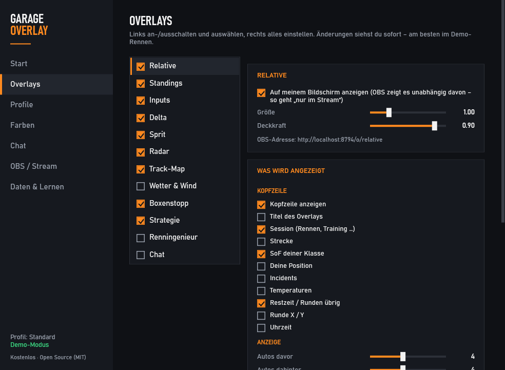
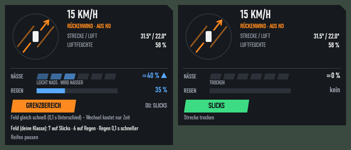
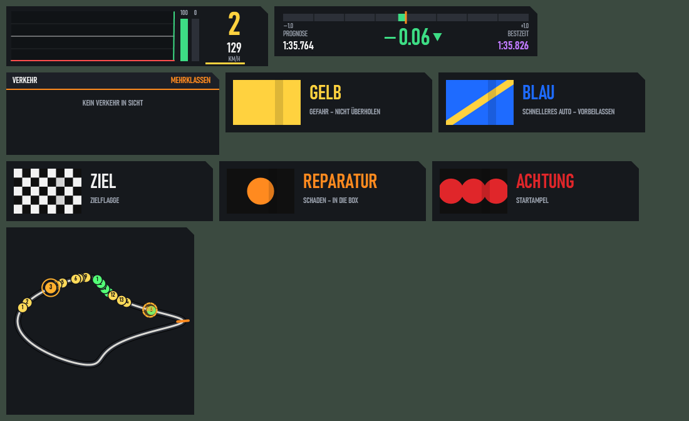

# 🏁 Garage Overlay – kostenlose iRacing-Overlays

**Kostenlos. Ohne Abo, ohne Anmeldung, ohne Werbung, ohne Cloud.**
Das Beste aus JRT, RaceLabs, P1Doks, iOverlay und irDrive in einem Tool.

### [⬇ GarageOverlay.exe herunterladen](https://github.com/MCSmug/garage-overlay/releases/latest)

---

## Installation

1. **[GarageOverlay.exe](https://github.com/MCSmug/garage-overlay/releases/latest)** herunterladen (unter „Assets“).
2. In einen festen Ordner legen, z. B. `C:\GarageOverlay\`, und starten. Kein Installer, kein .NET nötig.
3. Windows fragt beim ersten Start evtl. nach („Der Computer wurde durch Windows geschützt“) → **Weitere Informationen → Trotzdem ausführen**.
4. iRacing starten – die Overlays erscheinen, sobald du im Auto sitzt, im Replay oder als Zuschauer.

**Update:** Gibt es eine neue Version, zeigt das Steuerfenster links unten **„NEUE VERSION ↓“**. Alte Version über das Taskleisten-Symbol beenden, neue exe starten – deine Einstellungen bleiben erhalten (`%APPDATA%\GarageOverlay`).

## Bedienung

| | |
|---|---|
| **Steuerfenster** | Doppelklick aufs Taskleisten-Symbol – Overlays an/aus, Spalten, Farben, Profile |
| **Verschieben** | **Strg + Umschalt + O** (oder Knopf „Overlays verschieben“), dann Overlay mit der Maus ziehen |
| **Größe** | im Verschiebe-Modus **Mausrad** – oder am **rechten/unteren Rand ziehen** (Breite / Anzahl Zeilen) |
| **Alle Overlays aus/ein** | Strg + Umschalt + H |
| **Profil wechseln** | Strg + Umschalt + P (oder automatisch je Training / Quali / Rennen) |
| **Sprit an iRacing senden** | Strg + Umschalt + F |

## Overlays

| Overlay | Was es zeigt |
|---|---|
| **Relative** | Autos vor und hinter dir mit Abstand, Lizenz + SR, iRating, BOX-Marker, Rundenabstand farbig; Warnung, wenn schnellere Autos aufschließen |
| **Standings** | Tabelle je Klasse: Abstand, Intervall, letzte/beste Runde, iRating-Prognose, gewonnene Plätze, Boxenstopps |
| **Fuel** | Reichweite in Runden, Verbrauch, Nachtankmenge, Spar-Ziel pro Runde – merkt sich den Verbrauch je Auto und Strecke |
| **Boxenstopp** | Wo du nach dem Stopp rauskommst und wer dann vor/hinter dir ist; in der Boxengasse Limiter-Warnung und Meter bis zur Box |
| **Wetter & Reifen** | Wind relativ zum Auto, Temperaturen, Nässe-Trend, Slicks/Regenreifen-Empfehlung aus dem Vergleich mit dem Feld |
| **Radar** | Autos neben dir, Warnflächen links/rechts |
| **Inputs** | Gas, Bremse, Lenkung, Gang mit Schaltblitz |
| **Delta** | ± zur Bestrunde mit Trend und Prognose |
| **Track-Map** | alle Autos in Klassenfarbe, „Geist“: wo du nach einem Boxenstopp wärst |
| **Rennflaggen & Verkehr** | gelb, blau, schwarz, Meatball …; schnellere Klassen, die dich gleich einholen |
| **Strategie / Renningenieur** | Stint- und Stopp-Planung, Hinweise im Rennen |
| **Chat** | Twitch-/YouTube-Chat (nur lesen) |

## Für Streamer (OBS)

Jedes Overlay gibt es als **Browserquelle mit transparentem Hintergrund**: Steuerfenster → „OBS / Stream“ → Adresse kopieren → in OBS „Quelle hinzufügen → Browser“. So geht auch „nur im Stream, nicht auf meinem Bildschirm“.

## Häufige Fragen

- **Ist das erlaubt?** Ja. Das Overlay liest nur die offizielle iRacing-Telemetrie – dieselbe Schnittstelle wie JRT, RaceLabs & Co. Es verändert nichts an iRacing.
- **Kostet das was?** Nein, und das bleibt so.
- **Hersteller-Logos fehlen?** Logos werden aus Markenrechtsgründen nicht mitgeliefert. Eigene PNGs in `%APPDATA%\GarageOverlay\logos\` legen (z. B. `Ferrari.png`) – oder eine vorhandene JRT-Installation wird automatisch genutzt.
- **Fehler gefunden / Wunsch?** Gern als [Issue](https://github.com/MCSmug/garage-overlay/issues) – am besten mit Bildschirmfoto und der Datei `%APPDATA%\GarageOverlay\overlay.log`.

---

### English

Free iRacing overlays – no subscription, no account, no ads. Download **[GarageOverlay.exe](https://github.com/MCSmug/garage-overlay/releases/latest)** and run it (no installer, no .NET required). Relative, standings, fuel, pit stop prediction, weather & tyres, radar, inputs, delta, track map, flags, OBS browser sources. The interface is currently in German.
